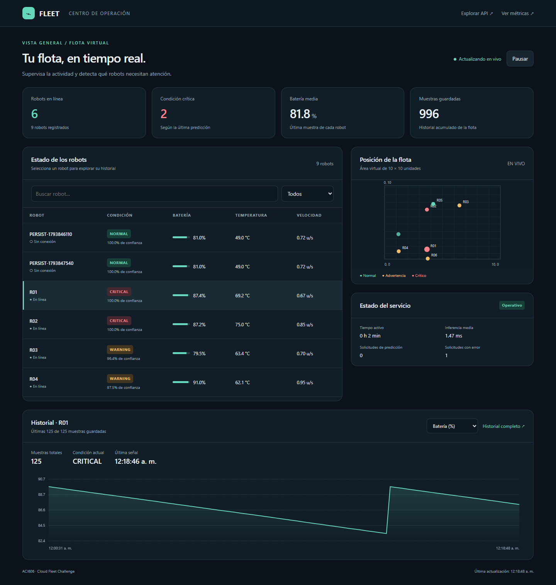
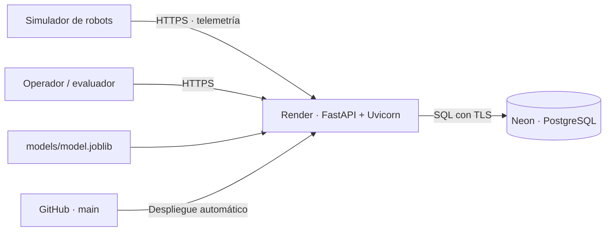

# ACI606 · Cloud Fleet Challenge

Plataforma de flotas desarrollada sobre el [starter del docente](https://github.com/DrOscarL/aci606-cloud-fleet-challenge) para el Ejercicio 4: telemetría persistente, clasificación de condición, panel de operación y métricas.

El panel utiliza superficies blancas, azul marino suave y textos de alto contraste. El mapa, los gráficos y las etiquetas de condición están adaptados al tema claro.

**Para abrir la demostración desde cualquier computador o celular**, entrar al [panel público](https://aci606-cloud-fleet-sebit44s.onrender.com/dashboard) y pulsar **Iniciar demostración**. El navegador envía mediciones de seis robots durante dos minutos. Se puede detener con el mismo botón o cerrando la pestaña. Las muestras y sus predicciones quedan guardadas en el historial.

El botón usa un escenario generado con `simulator/core.py` y envía las muestras a `/telemetry`. Cada ejecución recibe identificadores propios. El panel incluye acceso a la API, las métricas y el código en GitHub.

En **Pruebas para la presentación** se puede obtener una predicción, probar el rechazo de datos inválidos y guardar 125 muestras para comprobar la persistencia. La referencia se guarda en el navegador. Después de reiniciar el servicio desde la cuenta de Render, el botón **Verificar tras reinicio** exige un identificador de arranque nuevo y el mismo historial completo. Las métricas completas se despliegan en esa misma sección.

<!-- deployment:start -->
Servicio: **[https://aci606-cloud-fleet-sebit44s.onrender.com](https://aci606-cloud-fleet-sebit44s.onrender.com)** · [Panel](https://aci606-cloud-fleet-sebit44s.onrender.com/dashboard) · [API](https://aci606-cloud-fleet-sebit44s.onrender.com/docs)

Repositorio: [https://github.com/goudetsebastian-cyber/aci606-cloud-fleet-challenge](https://github.com/goudetsebastian-cyber/aci606-cloud-fleet-challenge)

Verificación pública: completa.
<!-- deployment:end -->



## Arquitectura y ubicación de los datos



En la nube los datos viven en la tabla `telemetry` de **Neon PostgreSQL**, independiente del disco efímero de Render. `DATABASE_URL` es una variable privada. El modelo y el panel se despliegan desde Git. En desarrollo se admite SQLite en `storage/fleet.db`; Render rechaza esa configuración para evitar una falsa persistencia. Ver [la explicación técnica](docs/ARCHITECTURE.md).

Se revisaron los materiales de persistencia y el laboratorio de sensores del curso: [correspondencia entre conceptos, implementación y evidencia](docs/ALINEACION_CLASES.md). Confirman la arquitectura elegida; el informe y la guía de defensa explican transacciones, índices, DBaaS y la diferencia entre persistencia y disponibilidad. El laboratorio de Colab es una práctica independiente y no cambia el contrato del Ejercicio 4.

## Ejecución local

Python 3.12 recomendado. Desde la carpeta del proyecto, en Windows:

```powershell
python -m venv .venv
.venv\Scripts\python.exe -m pip install -r requirements.txt
.venv\Scripts\python.exe -m uvicorn app.main:app --host 127.0.0.1 --port 8000
```

En otra consola:

```powershell
.venv\Scripts\python.exe simulator/fleet_simulator.py --api http://127.0.0.1:8000 --robots 6
```

Abrir [el panel local](http://127.0.0.1:8000/dashboard) o [la documentación interactiva](http://127.0.0.1:8000/docs). En este equipo, `VER_DEMO.cmd` abre una demostración con el entorno ya preparado; la ventana permite detener los procesos que inició.

Para la defensa en la nube, `VER_DEMO_NUBE.cmd` abre el panel público y conecta seis robots al servicio de Render. Mantener abierta su ventana durante la demostración; pulsar Enter detiene únicamente esos robots.

En Linux/macOS, los equivalentes son `python3 -m venv .venv` y `.venv/bin/python` en los demás comandos. No es necesario activar el entorno. El modelo entrenado está incluido; no hace falta entrenarlo para iniciar la API.

Si se desea usar PostgreSQL localmente, definir `DATABASE_URL` antes de iniciar. No se carga `.env` automáticamente. La aplicación acepta las cadenas `postgresql://`, `postgres://` y `postgresql+psycopg://` y usa psycopg 3.

## Contratos de la API

| Método y ruta | Resultado |
|---|---|
| `GET /health` | Disponibilidad de base y modelo, versión e identificador del proceso |
| `POST /telemetry` | Valida, predice y confirma una transacción persistente |
| `GET /robots` | Última muestra por robot, predicción, conexión y conteo histórico |
| `GET /robots/{robot_id}/history` | Historial completo, sin truncamiento a 100; `limit` y `offset` opcionales |
| `POST /predict` | Predicción real del pipeline, sin crear una muestra histórica |
| `GET /metrics` | Solicitudes, errores, latencias, uptime, robots, muestras y modelo |
| `GET /dashboard` | Panel adaptable a escritorio y teléfono |

Ejemplo de cuerpo para `/telemetry` y `/predict`:

```json
{
  "robot_id": "R03", "timestamp": 1780000000.0,
  "x": 4.21, "y": 7.82, "speed": 0.63, "battery": 71.0,
  "motor_temp": 48.2, "vibration": 0.43,
  "motor_current": 3.7, "obstacle_distance": 0.42
}
```

`/predict` devuelve exactamente `robot_id`, `predicted_status`, `confidence`, `model_version` e `inference_ms`. Las clases son `NORMAL`, `WARNING` y `CRITICAL`. Se rechazan campos ausentes o adicionales, tipos incorrectos, NaN/infinito, batería fuera de 0-100 y magnitudes no negativas fuera de rango mediante 422. Un robot inexistente devuelve 404; un fallo de base, 503 sin credenciales.

## Modelo y evidencia

Se generaron **32.768 muestras de 64 flotas independientes**, con el simulador original sin modificar. Se excluyeron identidad, timestamp y posición de las variables. GroupShuffleSplit reservó 16 flotas (8.192 filas) para prueba; las otras 48 (24.576 filas) se usaron para entrenamiento y GroupKFold de cuatro particiones. La elección se basó solo en validación.

| Clasificador | F1 macro de validación | F1 macro de prueba |
|---|---:|---:|
| Regresión logística | 0,9249 | **0,9260** |
| Random Forest | 0,9202 | 0,9229 |
| Clase mayoritaria | — | 0,1982 |

Consultar [el reporte del modelo](reports/MODEL_REPORT.md), que contiene EDA, distribuciones, comparación y matriz de confusión. Las métricas de detalle y las listas de flotas están en [evaluation.json](reports/evaluation.json). Si difiere un valor redondeado de esta tabla, la evidencia JSON es la fuente exacta.

Se seleccionó **regresión logística**, con imputación y escalado incluidos en `models/model.joblib`. Su F1 de validación es mayor y su coste es menor. La versión publicada en el artefacto es `v1-lr-39cbd0a465`; el SHA-256 del dataset permite comprobar su origen. El pipeline se ajustó exclusivamente con las flotas de entrenamiento.

Para reproducir dataset, entrenamiento y figuras:

```powershell
.venv\Scripts\python.exe -m pip install -r requirements-dev.txt
.venv\Scripts\python.exe ml/generate_fleets.py
.venv\Scripts\python.exe ml/train_model.py
```

Para regenerar el informe técnico PDF, instalar `requirements-report.txt` y ejecutar `python scripts/build_report.py`. La salida se escribe en `output/pdf/` y refleja el estado de despliegue registrado, sin asumir verificaciones pendientes.

`simulator/generate_dataset.py` se conserva como starter; para esta evaluación se usa `ml/generate_fleets.py`, que agrega `fleet_id` e identifica cada flota con una semilla independiente. Los datos son sintéticos; la evidencia no acredita desempeño en robots reales. `confidence` es probabilidad estimada, sin evaluación independiente de calibración.

## Pruebas y operación

```powershell
.venv\Scripts\python.exe -m pytest -q
.venv\Scripts\python.exe tests/smoke_test.py --api http://127.0.0.1:8000 --final
.venv\Scripts\python.exe tests/evaluate_remote.py --api http://127.0.0.1:8000 --output reports/local_unseen_evaluation.json
```

El test de servicio verifica el contrato, 130 muestras intactas tras crear una instancia nueva, concurrencia, muestras fuera de orden, errores de validación, NaN e infinito y fallos de base. La evaluación por HTTP usa 512 muestras de cuatro flotas nuevas, ocho solicitudes concurrentes y leves cambios en los sensores. Los resultados locales son evidencia local; no se presentan como latencia de internet.

En la URL pública de Render: **512/512 respuestas válidas, cero solicitudes fallidas, F1 macro 0,9267 y p95 de 275,32 ms** desde el cliente. Se verificaron 125 muestras idénticas después de redesplegar el mismo commit, con cambio de `instance_id`. El estudiante confirmó la apertura desde otro dispositivo. La evidencia está en `reports/remote_evaluation.json`, `reports/persistence_snapshot.json` y `reports/other_device_check.json`.

`/metrics` cuenta intentos válidos e inválidos de telemetría y predicción. Las inferencias automáticas de ingesta se distinguen de `/predict`. La latencia media interna incluye ambas; p50/p95 usan las últimas 2.000 inferencias. Los contadores y el uptime corresponden al proceso y se reinician; muestras, predicciones e historial sobreviven en la base. Un robot se considera conectado si envió datos en los últimos 30 segundos.

Para publicar y comprobar la persistencia después de un reinicio real de Render, seguir [DEPLOYMENT.md](docs/DEPLOYMENT.md). El comando `tests/check_persistence.py` compara 125 muestras, su huella y el cambio de `instance_id`. Antes de la defensa se debe activar el servicio con `/health`, porque el plan gratuito puede arrancar en frío.

## Mapa de entrega

| Criterio | Implementación / evidencia |
|---|---|
| Persistencia completa | `app/db.py`, prueba de 130 muestras, comprobación por hash |
| ML reproducible | `ml/`, `models/`, `reports/MODEL_REPORT.md` |
| Contrato e inferencia | `app/schemas.py`, `app/inference.py`, smoke test final |
| Panel | `dashboard/index.html`, capturas de escritorio y móvil |
| Observabilidad | `app/observability.py`, `/metrics` |
| Git | Rama `feature/cloud-platform`, commits reales y merge a `main` |
| PaaS | `render.yaml`, guía de despliegue, estado público registrado |
| Defensa | `docs/DEFENSA.md` |
| Relación con la materia | `docs/ALINEACION_CLASES.md` e informe técnico |

El historial original del docente se conserva. Los cambios de esta implementación tienen commits propios de asistencia, sin fechas o contribuciones ficticias. Las credenciales y las bases locales se excluyen de Git.

## Referencias

- Loyola, O. (2026). *Ejercicio 4: Cloud Fleet Challenge. Del prototipo local a un servicio desplegado en una plataforma PaaS*. Pauta facilitada por el estudiante.
- Loyola, O. (2026). *Persistencia y servicios de datos en Cloud*. Clase facilitada por el estudiante, 19 páginas.
- Loyola, O. (2026). *Laboratorio: servicio persistente de datos de sensores. FastAPI + SQLite + cliente generador de mediciones*. Guía para Google Colab facilitada por el estudiante, 11 páginas.
- [Repositorio base](https://github.com/DrOscarL/aci606-cloud-fleet-challenge)
- [scikit-learn: GroupShuffleSplit](https://scikit-learn.org/stable/modules/generated/sklearn.model_selection.GroupShuffleSplit.html)
- [Render: FastAPI](https://render.com/docs/deploy-fastapi)
- [Render: plan gratuito](https://render.com/docs/free)
- [Neon: planes](https://neon.com/docs/introduction/plans)
