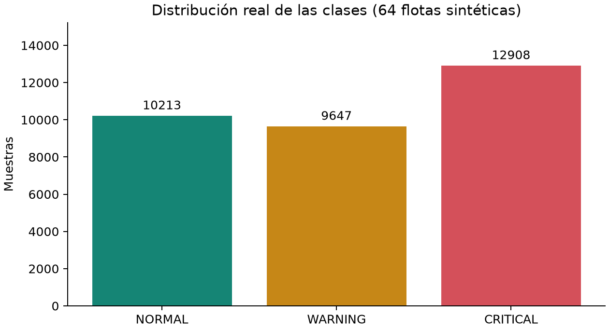
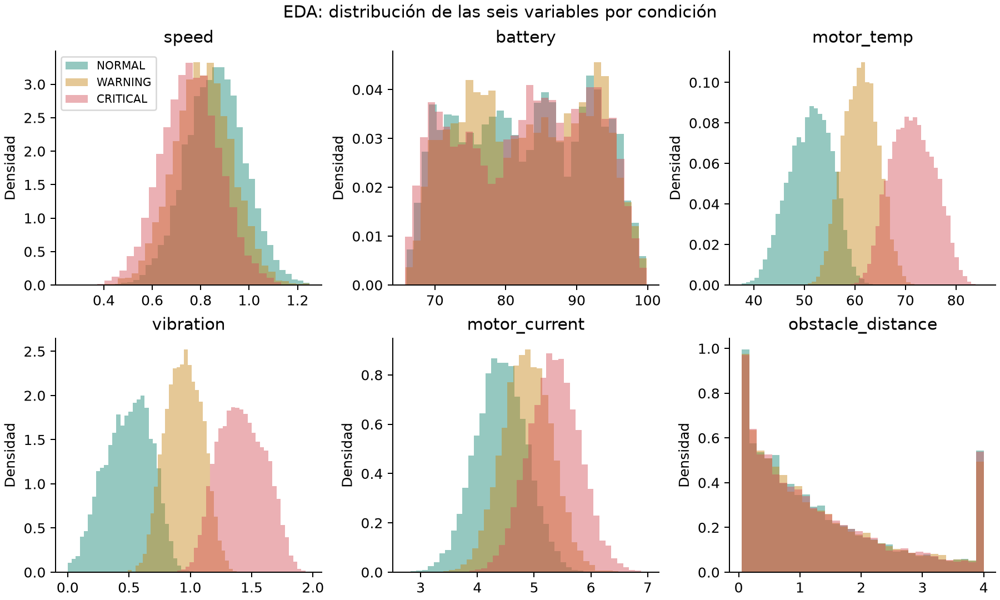
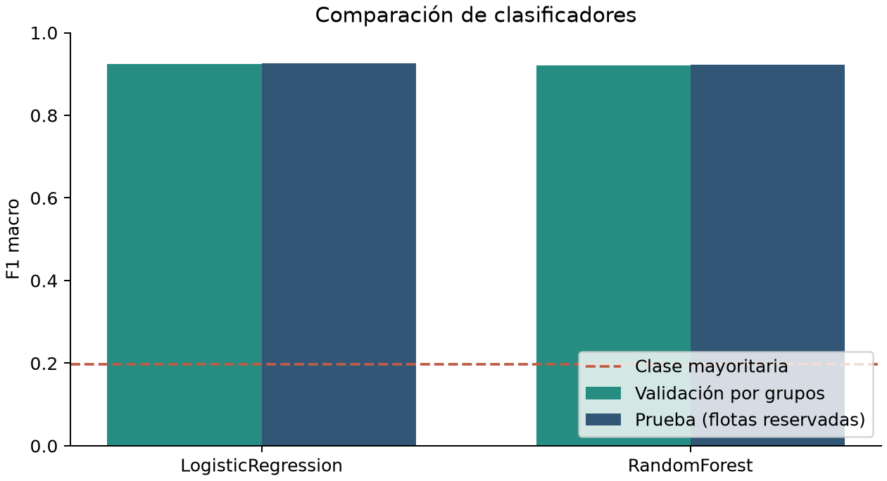
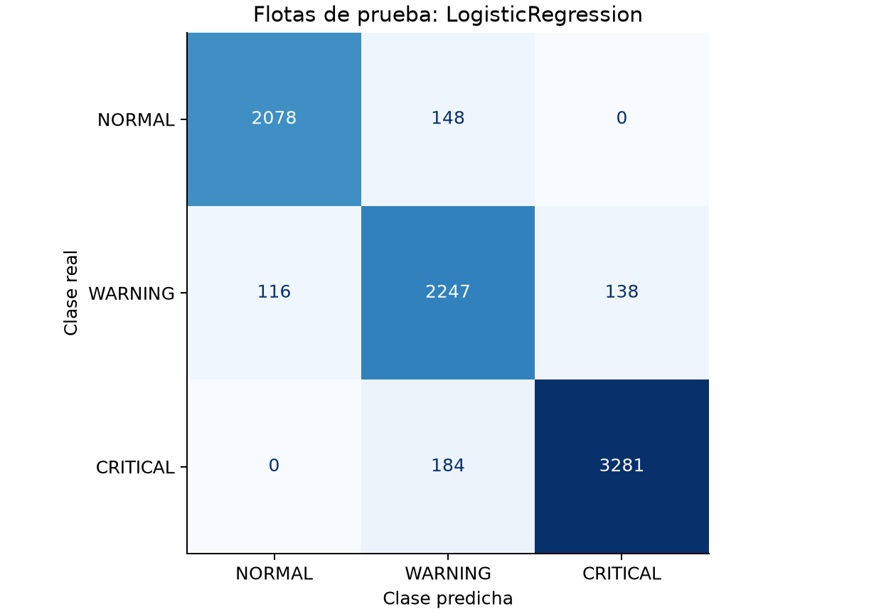

# Evidencia del modelo

Dataset sintético: **32,768 muestras y 64 flotas**, semilla 606.
Generado con `ml/generate_fleets.py` a partir de `simulator/core.py`, conservado sin cambios.
SHA-256: `39cbd0a465ac14f0ef0ca7816f72b3f56be677baf5d8fca49d0dcf9f6dce5de9`.

## EDA y variables

Clases: {'NORMAL': 10213, 'WARNING': 9647, 'CRITICAL': 12908}. Ausentes: 0.
Se registran los conteos observados, sin asumir que CRITICAL sea la clase minoritaria.
Se usan velocidad, batería, temperatura, vibración, corriente y distancia al obstáculo.
Los histogramas muestran que temperatura y vibración separan mejor las condiciones;
velocidad, batería y distancia presentan más solapamiento. Esto describe asociación, no causalidad.
Se excluyen fleet_id, robot_id, timestamp, x e y para evitar memorizar identidad o trayectoria.

## Separación y elección

GroupShuffleSplit reserva 25% de las flotas: 48 flotas / 24,576 muestras de entrenamiento;
16 flotas / 8,192 muestras de prueba. Intersección de grupos: cero.
El entrenamiento usa GroupKFold de cuatro particiones. Imputación y escalado se ajustan dentro de cada pipeline y partición.
La selección se fija con F1 macro de validación; si la diferencia es menor o igual a 0,005 se prefiere la regresión logística.
La prueba se consulta después de fijar esa elección. El artefacto conserva el ajuste exclusivo a las flotas de entrenamiento.

| Clasificador | F1 macro validación (media ± DE) | F1 macro prueba | Inferencia local media (ms) |
|---|---:|---:|---:|
| LogisticRegression | 0.9249 ± 0.0026 | 0.9260 | 1.115 |
| RandomForest | 0.9202 ± 0.0035 | 0.9229 | 8.435 |

Línea base de clase mayoritaria: **0.1982** F1 macro.
Seleccionado: **LogisticRegression**. La regresión logística alcanza el mejor resultado o queda a menos de 0,005 del mejor F1 de validación. Su coste de inferencia y tamaño son menores, adecuados para el plan gratuito.
La latencia anterior mide el pipeline, no la red ni el arranque en frío del PaaS.

## Reproducibilidad y alcance

Versión `v1-lr-39cbd0a465`; scikit-learn 1.9.1; Python 3.12.14.
`models/model.joblib` contiene imputación, escalado cuando corresponde, clasificador, variables y versión.
Listas completas de flotas, clasificación por clase, matrices de ambos modelos y estadísticas en `evaluation.json`.

Datos sintéticos del simulador docente. No acreditan desempeño en robots reales. Confidence es probabilidad estimada, sin calibración independiente.
La evaluación pública y la flota del docente son verificaciones distintas de esta prueba reservada.
